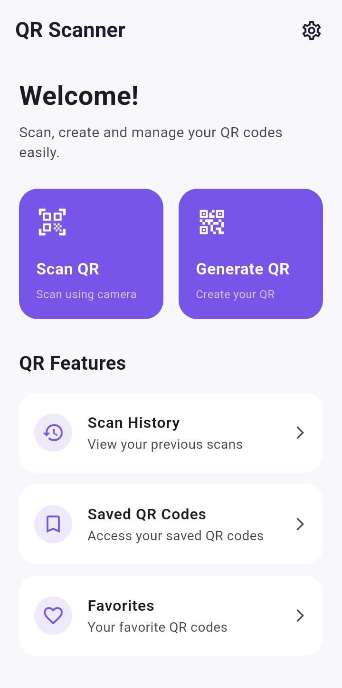
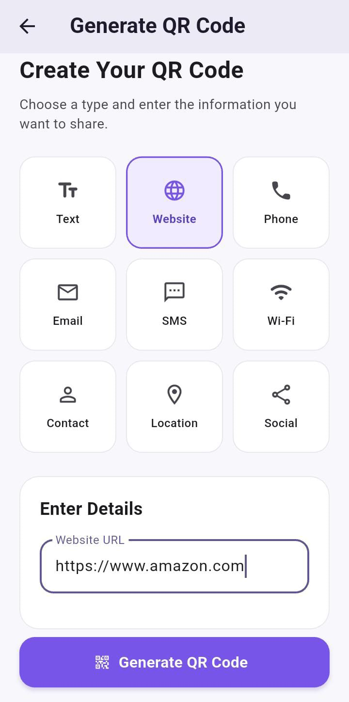
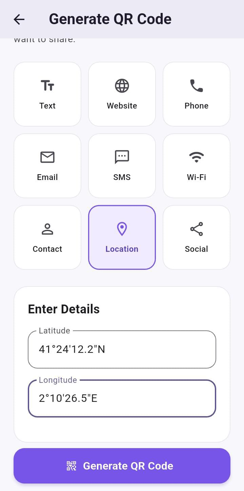
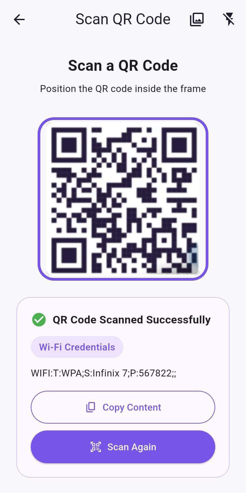
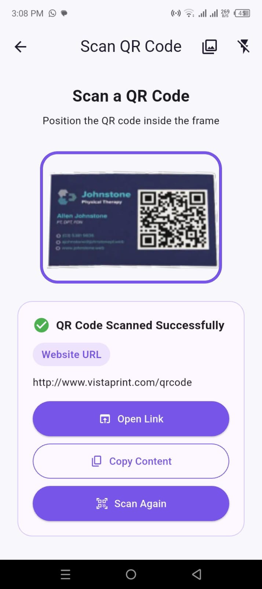
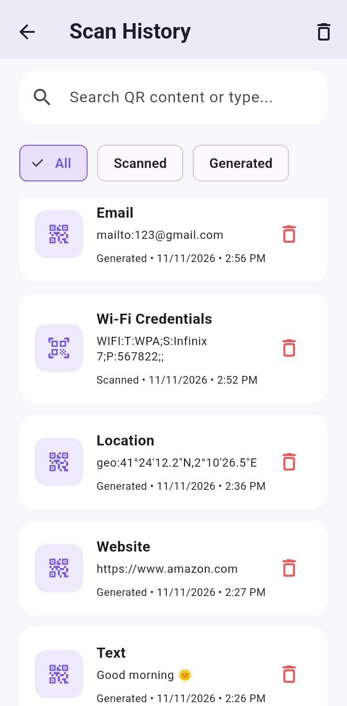
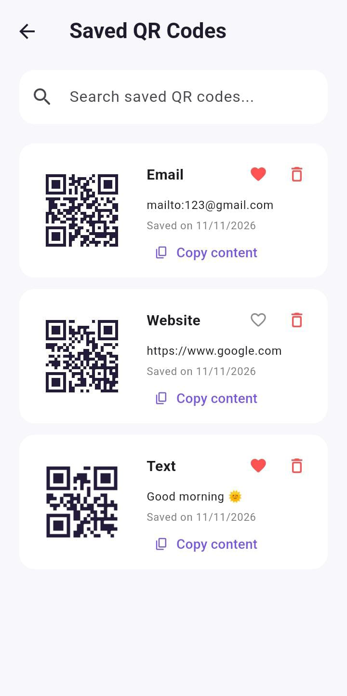
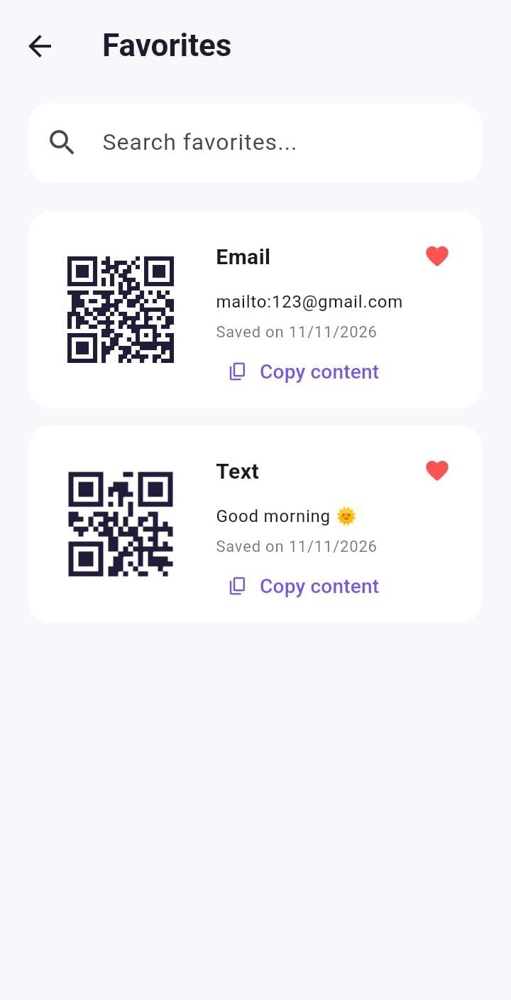
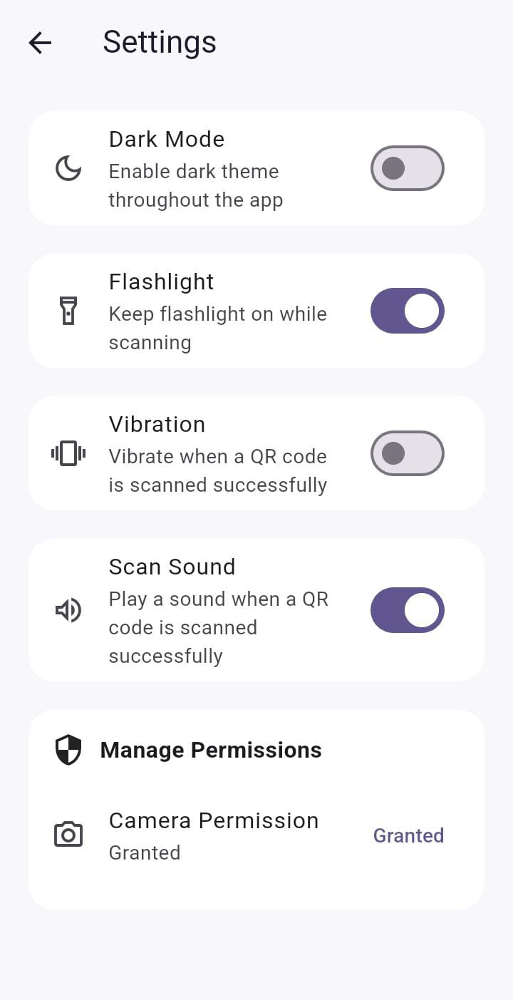
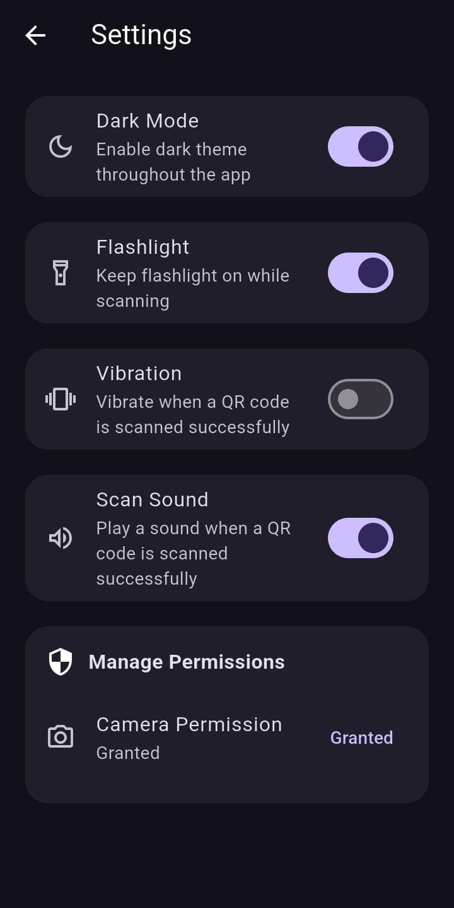

<div align="center">

# 📱 QR SCANNER & GENERATOR
### Scan Smarter. Create Instantly. Stay Organized.


</div>

---

## 📖 Overview

QR Scanner & Generator is a Flutter-based mobile application designed to provide a simple and convenient way to scan, create, save, and manage QR codes.

Users can scan QR codes using their device camera or select images from their gallery. They can also generate QR codes for websites, text, phone numbers, email, SMS, Wi-Fi, contacts, locations, and social profiles.

The application includes QR history, saved QR codes, favorites, image sharing, and customizable appearance settings with light and dark modes.

## 📱 App Preview

### 🏠 Home Screen

<div align="center">

</div>

### ✨ QR Code Generator
Generate QR codes for multiple information types, including Text, Website, Phone, Email, SMS, Wi-Fi, Contact, Location, and Social Profiles.
<div align="center">
<table>
<tr>
<td align="center">

<br/><b>Website Details</b>
</td>
<td align="center">

<br/><b>Generated Website QR</b>
</td>
</tr>
<tr>
<td align="center">

<br/><b>Location Details</b>
</td>
<td align="center">

<br/><b>Generated Location QR</b>
</td>
</tr>
</table>
</div>

### 📷 QR Code Scanner

<div align="center">
<table>
<tr>
<td align="center">

<br/><b>Camera Scanning</b>
</td>
<td align="center">

<br/><b>Gallery Image Scanning</b>
</td>
</tr>
</table>
</div>

### 🕘 History, Saved QR & Favorites

<div align="center">
<table>
<tr>
<td align="center">

<br/><b>QR History</b>
</td>
<td align="center">

<br/><b>Saved QR Codes</b>
</td>
<td align="center">

<br/><b>Favorites</b>
</td>
</tr>
</table>
</div>

### ⚙️ Settings & Appearance

<div align="center">
<table>
<tr>
<td align="center">

<br/><b>Light Mode</b>
</td>
<td align="center">

<br/><b>Dark Mode</b>
</td>
</tr>
</table>
</div>

---

## ✨ Key Features

### 📷 QR Code Scanning
- Scan QR codes instantly using the device camera.
- Scan QR codes from images in the gallery.
- Automatically detect QR code content.
- Open supported links.
- Copy scanned content to the clipboard.
- Flashlight support while scanning.

### 🎨 QR Code Generation
Generate QR codes for multiple information types:

- Plain Text
- Website / URL
- Phone Number
- Email
- SMS
- Wi-Fi
- Contact
- Location
- Social Profiles

### 🖼️ QR Preview & Export
- Preview generated QR codes before saving.
- Customize QR code colors.
- Save QR code images to the device gallery.
- Share generated QR codes through available applications.
- Copy QR content.

### 🕘 History Management
- View scanned QR code history.
- View generated QR code history.
- Search previous QR activities.
- Filter history by activity type.
- Delete individual history records.
- Clear all history.

### 💾 Saved QR Codes
- Save generated QR codes for future access.
- View saved QR codes.
- Copy saved QR content.
- Delete saved QR codes.
- Prevent duplicate saved entries.

### ❤️ Favorites
- Mark saved QR codes as favorites.
- View favorite QR codes separately.
- Search favorite items.
- Remove items from favorites.

### ⚙️ Settings & Customization
- Switch between light and dark themes.
- Enable or disable flashlight.
- Enable or disable vibration after successful scanning.
- Enable or disable scan sound.
- Check camera permission status.
- Request camera permission.
- Open device app settings when permission is permanently denied.

---

## 🔄 Application Flow

```text
          Splash / Home Screen
                  |
          -------------------
          |        |        |
        Scan    Generate  Settings
          |        | 
       Camera    QR Type
          |        |
       Gallery   Enter Details
          |        |
      Scan Result  QR Preview
          |        |
     Open / Copy  Save / Share
          |        |
          ----------------
                  |
             QR History
                  |
          -------------------
          |                 |
       Saved QR          Favorites
```

---

## 🛠️ Technology Stack

| Technology | Purpose |
|---|---|
| Flutter | Mobile application development |
| Dart | Programming language |
| Material Design | User interface |
| Provider | State management |
| mobile_scanner | Camera-based QR scanning |
| qr_flutter | QR code generation and preview |
| image_picker | Selecting images from gallery |
| SQLite (sqflite) | Local history and saved QR storage |
| shared_preferences | Saving app preferences |
| path_provider | File and directory access |
| share_plus | Sharing QR images |
| gal | Saving images to device gallery |
| url_launcher | Opening supported links |
| permission_handler | Camera permission management |
| vibration | Haptic feedback |
| audioplayers | Scan sound playback |
| VS Code | Development environment |
| Android SDK | Android application development |

---

## 📁 Project Structure

```text
flutter_qr_code_scanner/
│
├── android/
├── assets/
│   └── audio/
│       └── scan_beep.wav
│
├── lib/
│   ├── models/
│   ├── providers/
│   ├── screens/
│   │   ├── home/
│   │   ├── scanner/
│   │   ├── generator/
│   │   ├── history/
│   │   ├── favorites/
│   │   ├── saved/
│   │   └── settings/
│   │
│   ├── services/
│   ├── utils/
│   ├── widgets/
│   └── main.dart
│
├── screenshots/
├── test/
├── pubspec.yaml
├── pubspec.lock
└── README.md
```

---

## 💾 Data Storage

The application uses local storage to maintain QR-related information and user preferences.

- **SQLite:** Stores scan history, generated QR history, saved QR codes, and favorite status.
- **SharedPreferences:** Stores theme and scanning preference settings.
- **Device Gallery:** Stores exported QR code images.

Data remains available after closing and reopening the application.

---

## 🚀 Getting Started

### Prerequisites

- Flutter SDK
- Dart SDK
- Android Studio or VS Code
- Android emulator or physical Android device

### Installation

**1. Clone the repository**

```bash
git clone https://github.com/LaraibMalik71/qr_scanner_generator.git
```

**2. Navigate to the project directory**

```bash
cd flutter_qr_code_scanner
```

**3. Install dependencies**

```bash
flutter pub get
```

**4. Run the application**

```bash
flutter run
```

---

## 🧪 Testing

Run Flutter static analysis:

```bash
flutter analyze
```

Run project tests:

```bash
flutter test
```

---

## 🎯 Project Objectives

- Provide a fast and convenient QR code scanning experience.
- Support scanning QR codes from both camera and gallery.
- Generate QR codes for different information types.
- Make saving and sharing QR codes simple.
- Maintain scan and generation history.
- Organize important QR codes using saved items and favorites.
- Provide an accessible interface with light and dark themes.

---

## 📌 Project Status

<div align="center">


**Completed — Internship Project**

</div>

---

## 👩‍💻 Developer

**Laraib Malik**

🎓 IT Student | Flutter Developer

🐙 GitHub: [@LaraibMalik71](https://github.com/LaraibMalik71)

📧 Email: hh2999720@gmail.com


